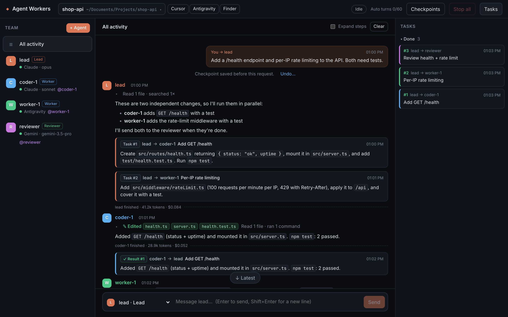

# Agent Workers

[English](README.md)



یک کنسول وب برای اداره‌ی تیمی از agentهای هوش مصنوعی (Claude Code، Gemini CLI، Antigravity یا هر CLI دیگر). هر agent مدل، اکانت، نقش و دسترسی خودش را دارد. Lead با تو حرف می‌زند و کار را بین بقیه پخش می‌کند، و همه‌ی ورودی‌ها و خروجی‌ها در یک کنسول دیده می‌شوند.

## اجرا

```bash
npm install
npm start
```

بعد http://127.0.0.1:4777 را باز کن.

## پروژه‌ها

- **پروژه** یک پوشه روی مک است. agentها مستقیم فایل‌های همان پوشه را می‌خوانند و تغییر می‌دهند و دستورهایش را اجرا می‌کنند.
- **انتخاب‌گر پروژه** بالای صفحه است. از همان‌جا می‌شود پروژه‌ی جدید ساخت (یک پوشه‌ی خالی با git ساخته می‌شود) یا یک پوشه‌ی موجود را باز کرد، و بین پروژه‌ها جابه‌جا شد.
- **تیم** برای همه‌ی پروژه‌ها یکی است، ولی هر پروژه مکالمه‌ها، تسک‌ها و لاگ خودش را دارد. agentها در هر پروژه کار قبلی همان پروژه را یادشان است.
- **باز کردن پروژه:** دکمه‌های Cursor، Antigravity و Finder پروژه را در همان برنامه باز می‌کنند.
- **Checkpoint:** قبل از هر پیامی که می‌فرستی، یک نسخه‌ی کامل از فایل‌ها ذخیره می‌شود (در `refs/agent-workers/` گیت). از دکمه‌ی **Checkpoints** می‌توانی پروژه را به هر نقطه برگردانی. commitها، branchها و staging خودت دست نمی‌خورند و خود برگرداندن هم قابل برگشت است. برای پوشه‌ای که git ندارد، دکمه‌ی «Enable checkpoints» این قابلیت را روشن می‌کند.

## چطور کار می‌کند

- هر agent یک CLI است که به‌صورت headless اجرا می‌شود (بدون ترمینال). خروجی‌اش (متن، ابزارهایی که صدا می‌زند و نتیجه‌ی آن‌ها) به‌صورت ساختاریافته خوانده و در کنسول نشان داده می‌شود. هر agent مکالمه‌ی خودش را دارد و بین پیام‌ها و حتی بعد از ری‌استارت سرور ادامه پیدا می‌کند.
- **Orchestrator** (`server/orchestrator.ts`) برای هر agent یک صندوق پیام دارد و هر agent در هر لحظه فقط یک نوبت اجرا می‌شود. هر نوبت worker یک تسک است. نتیجه‌ها و پیام‌هایی که در صف جمع شده‌اند با هم در یک نوبت فرستاده می‌شوند تا توکن کمتری مصرف شود.
- agentها با چند تگ ساده در متن جوابشان با هم حرف می‌زنند، پس این روش با هر مدلی کار می‌کند:
  - `<task to="worker-1" title="...">دستورالعمل کامل</task>`: Lead تسک می‌سازد.
  - `<message to="...">...</message>`: پیام کوتاه به یک agent دیگر.
  - `<blocked>دلیل</blocked>`: worker اعلام می‌کند نمی‌تواند تسک را تمام کند.

  جواب نهایی worker خودکار نتیجه‌ی تسک می‌شود و برای Lead فرستاده می‌شود.
- **سقف نوبت خودکار:** اگر agentها بدون پیام جدید از طرف تو بیش از ۶۰ نوبت به هم کار بدهند، تیم متوقف می‌شود (دکمه‌ی Resume ادامه می‌دهد). دکمه‌ی Stop all هم همه را فوراً متوقف می‌کند.

## تنظیمات هر agent

| گزینه | توضیح |
|---|---|
| Provider | `claude`، `gemini`، `agy` (Antigravity)، یا یک دستور دلخواه (`{prompt}` جای پیام قرار می‌گیرد) |
| Model | هر مدلی که آن CLI قبول کند (مثلاً `opus`، `sonnet`، `gemini-3.5-pro`) |
| Account | خالی یعنی یک لاگین جدا به اسم خود agent. `default` یعنی لاگین معمولی‌ات. agentهایی که اسم اکانت یکسان دارند یک لاگین مشترک دارند. لاگین‌ها در `~/.agent-workers/accounts/<name>` ذخیره می‌شوند. برای لاگین از منوی agent گزینه‌ی «Sign in» را بزن. |
| Role | Lead (برنامه‌ریزی و تقسیم کار)، Worker، Reviewer یا Custom. هر مدلی می‌تواند هر نقشی داشته باشد. |
| Permissions | Read-only، Edit files (بدون اجرای دستور)، Auto (اجرای دستور؛ Claude دستورهای خطرناک را غربال می‌کند)، Full access |
| Sandbox | برای Gemini و Antigravity، دستورها را در محیط محدود اجرا می‌کند |

## امنیت

سرور فقط روی `127.0.0.1` گوش می‌دهد. هر درخواست به API و WebSocket یک توکن تصادفی لازم دارد که موقع اجرا ساخته می‌شود. درخواست‌هایی که هدرِ `Host` آن‌ها این سرور نیست رد می‌شوند تا صفحه‌های وب نتوانند با DNS rebinding به آن دسترسی پیدا کنند.

## توسعه

```bash
npm run typecheck   # بررسی TypeScript
npm test            # تست‌ها؛ به‌جای agent واقعی یک CLI ساختگی اجرا می‌شود و توکنی مصرف نمی‌شود
```

## ساختار

```
server/   TypeScript: orchestrator، adapterهای هر CLI، API و WebSocket
web/      React + TypeScript: کنسول
test/     تست‌ها (node:test)
docs/     اسکرین‌شات‌ها
data/     تیم، لیست پروژه‌ها، و تسک‌ها، sessionها و لاگ هر پروژه (در git نیست)
legacy/   نسخه‌ی اول (ترمینال‌محور)
```
