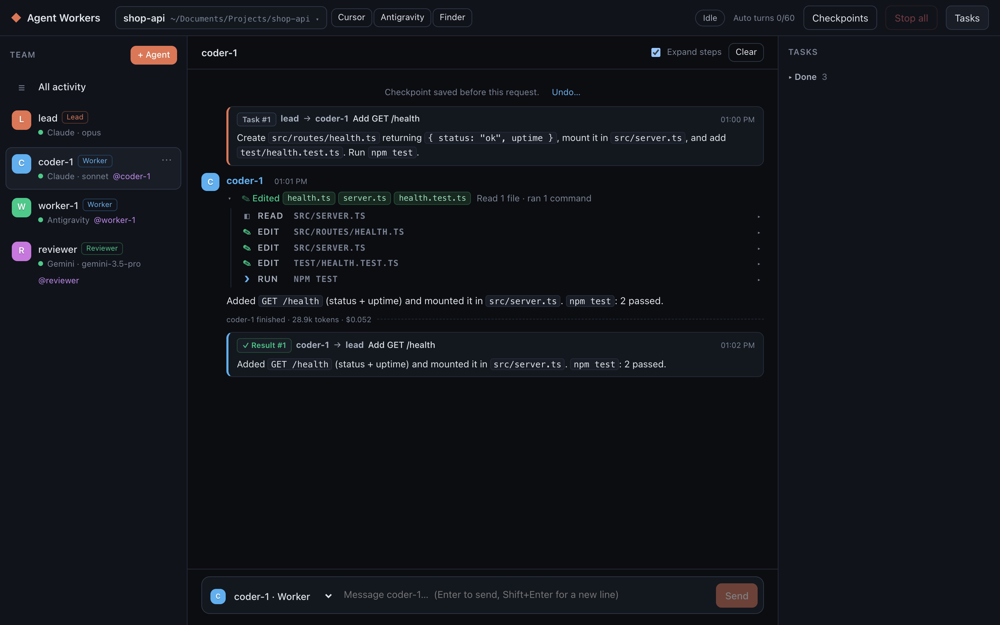
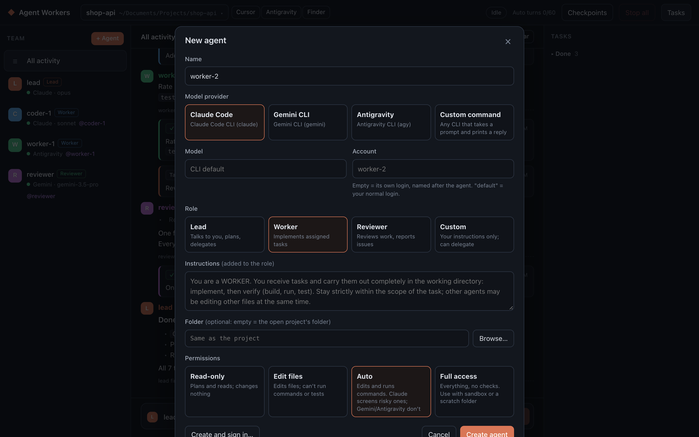
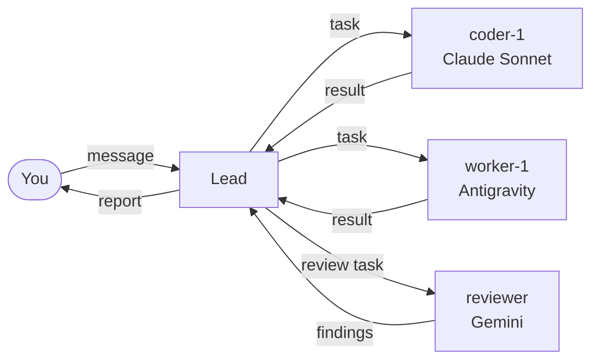

<div align="center">

# Agent Workers

**Run a team of AI coding agents — Claude Code, Gemini CLI, Antigravity or any CLI — from one local web console.**

A lead agent talks to you, plans the work and hands tasks to workers that run in parallel on your project.
Every step is visible, every request can be undone.

[فارسی](README.fa.md)


</div>

## Why

Coding agents are good at focused tasks, but one agent working through a long list is slow, and juggling several terminals by hand is tedious. Agent Workers turns the CLIs you already use into a team:

- **One conversation, many agents.** You talk to the lead; it splits the work, delegates and reports back.
- **Mix models and providers.** An Opus lead, Sonnet workers, an Antigravity worker and a Gemini reviewer can share one project.
- **Separate accounts.** Each agent can sign in to its own account, so one team can spread the work over several subscriptions.
- **Nothing is hidden.** Every message, task, tool call and result shows up in the console as it happens.
- **Safe to experiment.** A checkpoint of the project is saved before each of your requests, and a click restores it.

## Features

| | |
|---|---|
| **Providers** | Claude Code, Gemini CLI, Antigravity CLI (`agy`), or any command that takes a prompt and prints a reply |
| **Roles** | Lead (plans and delegates), Worker, Reviewer, or Custom with your own instructions |
| **Parallel work** | Each agent has its own inbox and runs one turn at a time; different agents work at the same time |
| **Projects** | A project is a folder on your machine; switch between projects, each with its own conversations, tasks and log |
| **Checkpoints** | Git snapshots under `refs/agent-workers/`, so your branches, commits and staging area are never touched |
| **Permissions** | Read-only, edit files, auto (commands allowed, risky ones screened by Claude) or full access, per agent |
| **Accounts** | `default` uses your normal login; any other name gets its own isolated sign-in |
| **Loop guard** | The team pauses after 60 automatic turns without a message from you, so it can't burn your quota |
| **Open in** | Open the project in Cursor, VS Code, Antigravity, Zed, Xcode, Finder or Terminal |

<table>
  <tr>
    <td width="50%"></td>
    <td width="50%"></td>
  </tr>
  <tr>
    <td align="center"><sub>Focus on one agent and expand every file it read, edited and ran</sub></td>
    <td align="center"><sub>Pick a provider, model, account, role and permission level for each agent</sub></td>
  </tr>
</table>

## Getting started

### Requirements

- **Node.js 20+** (developed on 22)
- **macOS** (Linux should work; the "open in editor" buttons are macOS only)
- At least one agent CLI installed and on your `PATH`:
  [Claude Code](https://docs.anthropic.com/en/docs/claude-code) (`claude`),
  [Gemini CLI](https://github.com/google-gemini/gemini-cli) (`gemini`) or
  [Antigravity CLI](https://antigravity.google/product/antigravity-cli/) (`agy`)
- `git`, for checkpoints

### Run

```bash
git clone https://github.com/javiddeveloper/Agent-Workers.git
cd Agent-Workers
npm install
npm start
```

Open **http://127.0.0.1:4777**. The first screen asks for a project folder, then offers ready-made teams (for example an Opus lead with two Sonnet workers). Use **Sign in** in an agent's menu to log it in to its account.

## How it works



Each agent is a CLI run headlessly in the project folder. Its streamed output (text, tool calls and their results) is parsed and shown in the console, and its conversation is resumed on every turn, even after a restart.

Agents talk to each other with a few plain-text tags, so the protocol works with any model:

```text
<task to="worker-1" title="Per-IP rate limiting">complete, self-contained instructions</task>
<message to="coder-1">a short note</message>
<blocked>why the task can't be finished</blocked>
```

The orchestrator (`server/orchestrator.ts`) keeps an inbox per agent and routes these:

- A worker's final reply becomes the task result and goes back to the agent that delegated it.
- Results and messages that pile up are batched into one turn to save tokens; tasks run one per turn, so each reply maps to one task.
- Tasks sent to an agent that doesn't exist are reported back to the sender, and the lead is told when agents join or leave the team.

## Configuration

### Agent settings

| Setting | Description |
|---|---|
| Provider | `claude`, `gemini`, `antigravity`, or a custom command (`{prompt}` is replaced by the message) |
| Model | Any model the CLI accepts, e.g. `opus`, `sonnet`, `gemini-3.5-pro` |
| Account | Empty = a separate login named after the agent; `default` = your normal login; agents with the same name share a login. Logins live in `~/.agent-workers/accounts/<name>` |
| Role | Lead, Worker, Reviewer or Custom; any model can take any role |
| Permissions | Read-only, Edit files (no commands), Auto (commands; Claude screens risky ones), Full access |
| Sandbox | Gemini and Antigravity only: run shell commands in a restricted sandbox |
| Folder | Optional; by default the agent works in the open project's folder |

### Environment variables

| Variable | Default | Purpose |
|---|---|---|
| `PORT` | `4777` | Port of the console |
| `AGENT_WORKERS_DATA` | `./data` | Where the team, projects, tasks and logs are stored |
| `AGENT_WORKERS_ACCOUNTS` | `~/.agent-workers/accounts` | Where separate agent logins are stored |

## Security

Agent Workers runs agents that can edit files and run commands on your machine, so the console is locked to your computer:

- The server listens on `127.0.0.1` only.
- Every API call and WebSocket needs a random token created at startup.
- Requests must name this server as their `Host`, which blocks DNS-rebinding attacks from web pages.
- The WebSocket also checks the page's `Origin`.

Give **Full access** only to agents working in a scratch folder or a sandbox, and keep checkpoints on (they need a git repository in the project folder).

## Development

```bash
npm run server      # start the server without rebuilding the UI
npm run build       # build the UI into dist/
npm run typecheck   # TypeScript check for server, UI and tests
npm test            # orchestrator, adapter, security and prompt tests
```

```text
server/   orchestrator, CLI adapters, git checkpoints, HTTP API and WebSocket (TypeScript)
web/      the console (React + TypeScript, built with Vite)
test/     node:test suites; agents are replaced by a fake CLI, so tests spend no tokens
docs/     screenshots
legacy/   the first, terminal-based version
data/     your team, projects, tasks and logs (not in git)
```
